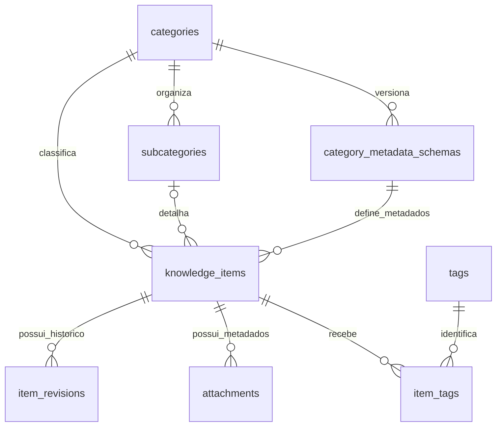

# Modelo relacional — fase 2

Modelo publicado na aplicação `0.2.0`, estrutura SQLite `2`, mantido na versão `0.3.0`. A versão atual acrescenta cadastro e edição com gravação transacional de revisões e mudanças, preservando a sonda da primeira fase. Anexos, backup, pesquisa, exclusão e sincronização continuam em etapas posteriores.

O SQL publicado está em `src/database/migrations/`. Os tipos de aplicação estão em `src/models/knowledge.ts`, e as validações em `src/services/knowledge-validation.ts`. Os exemplos de categorias são definições de código, não registros inseridos automaticamente no banco.

## Relacionamentos



Um item sempre pertence a uma categoria e a uma versão de definição de metadados dessa mesma categoria. A subcategoria é opcional. A chave estrangeira composta `(category_id, subcategory_id)` impede usar uma subcategoria de outra categoria; `(category_id, metadata_schema_version)` faz o mesmo para a definição dos metadados.

As conexões habilitam e conferem `PRAGMA foreign_keys = ON`. As referências usam `ON UPDATE RESTRICT`. A exclusão física é restrita nas relações principais; somente os vínculos de `item_tags` usam `ON DELETE CASCADE`. A opção por chaves e índices compostos segue os requisitos de correspondência de chaves descritos pelo [SQLite — foreign keys](https://sqlite.org/foreignkeys.html).

## Dicionário das tabelas

As dez tabelas da biblioteca e sua infraestrutura coexistem com a sonda preservada, totalizando onze tabelas gerenciadas. Tabelas internas, como `sqlite_sequence`, ficam fora dessa contagem.

| Tabela | Campos e finalidade | Chaves e regras principais |
| --- | --- | --- |
| `categories` | `id`, `name`, `name_key`, `description`, campos de ciclo de vida | UUID como PK; `name_key` único, inclusive em registros excluídos logicamente. |
| `category_metadata_schemas` | `category_id`, `version`, `definition_version`, `schema_json`, `created_at` | PK `(category_id, version)`; FK para categoria; `definition_version = 1`; definição imutável por `UPDATE`. |
| `subcategories` | `id`, `category_id`, `name`, `name_key`, `description`, ciclo de vida | PK UUID; únicos `(category_id, name_key)` e `(category_id, id)`; FK para categoria. |
| `tags` | `id`, `name`, `name_key`, ciclo de vida | PK UUID; `name_key` único. |
| `knowledge_items` | Campos detalhados na próxima seção | PK UUID; FKs para categoria, subcategoria e versão de metadados. |
| `item_tags` | `item_id`, `tag_id`, `created_at` | PK `(item_id, tag_id)`; ambos os vínculos têm exclusão física em cascata. |
| `attachments` | `id`, `item_id`, `original_name`, `mime_type`, `byte_size`, `storage_key`, `sha256`, ciclo de vida | PK UUID; FK restritiva para item; chave de armazenamento relativa e única; tamanho inteiro não negativo; hash opcional. Guarda somente metadados. |
| `item_revisions` | `id`, `item_id`, `revision`, `snapshot_json`, `snapshot_version`, `created_at` | PK UUID; único `(item_id, revision)`; FK restritiva para item; objeto JSON e `snapshot_version = 1`. |
| `change_log` | `sequence`, `id`, `entity_type`, `entity_id`, `operation`, `revision`, `base_revision`, `device_id`, `changed_at`, `payload_json`, `payload_version` | Sequência inteira local autoincremental; UUID de mudança único; `0 <= base_revision < revision`; objeto JSON e `payload_version = 1`. Referência polimórfica sem FK direta. |
| `schema_migrations` | `version`, `name`, `checksum`, `applied_at` | PK de versão; nome único; checksum SHA-256 em hexadecimal minúsculo; data UTC da aplicação ou adoção. |
| `persistence_probe` | `id`, `content`, `created_at` | Tabela histórica da fase 1, com seu contrato original e registros preservados. Não foi convertida para `knowledge_items`. |

O ciclo de vida comum a categorias, subcategorias, tags, itens e metadados de anexos contém `created_at`, `updated_at`, `deleted_at` e `revision`. As tabelas de vínculo, definições, snapshots e log possuem os campos de data e versão indicados em seus próprios contratos.

## Campos de `knowledge_items`

| Campo | Representação SQLite | Regra ou valor inicial |
| --- | --- | --- |
| `id` | `TEXT NOT NULL`, PK | UUID canônico em hexadecimal minúsculo. |
| `title` | `TEXT NOT NULL` | Texto obrigatório, até 300 caracteres. |
| `category_id` | `TEXT NOT NULL` | Categoria existente. |
| `subcategory_id` | `TEXT`, opcional | `NULL` ou subcategoria da categoria indicada. |
| `summary` | `TEXT NOT NULL` | Até 2.000 caracteres; padrão `''`. |
| `content` | `TEXT NOT NULL` | Até 1.000.000 de caracteres; padrão `''`. |
| `source_url` | `TEXT`, opcional | `NULL`, `''` ou URL HTTP/HTTPS de até 2.048 caracteres. |
| `source_platform` | `TEXT`, opcional | `NULL` ou texto de até 120 caracteres, inclusive vazio. |
| `source_author` | `TEXT`, opcional | `NULL` ou texto de até 300 caracteres, inclusive vazio. |
| `favorite` | `INTEGER NOT NULL` | `0` ou `1`; padrão `0`. O DTO usa booleano e exige conversão explícita na futura persistência. |
| `status` | `TEXT NOT NULL` | `unread`, `reading`, `studying`, `completed` ou `archived`; padrão `unread`. |
| `personal_notes` | `TEXT NOT NULL` | Até 100.000 caracteres; padrão `''`. |
| `metadata_schema_version` | `INTEGER NOT NULL` | Inteiro positivo; padrão `1`. A versão precisa existir para a categoria. |
| `metadata_json` | `TEXT NOT NULL` | Objeto JSON serializado, até 100.000 caracteres; padrão `'{}'`. O DTO usa objeto. |
| `created_at` | `TEXT NOT NULL` | UTC normalizado com milissegundos. |
| `updated_at` | `TEXT NOT NULL` | UTC normalizado, maior ou igual a `created_at`. |
| `deleted_at` | `TEXT`, opcional | `NULL` ou data entre `created_at` e `updated_at`. |
| `revision` | `INTEGER NOT NULL` | Inteiro positivo; padrão `1`. |

Uma categoria precisa ter sua definição de metadados cadastrada antes de receber itens. Uma definição com `fields: []` permite metadados vazios, sem criar categorias ou versões implicitamente.

## Identificadores, datas e exclusão lógica

Os novos UUIDs seguem `xxxxxxxx-xxxx-xxxx-xxxx-xxxxxxxxxxxx`, com 32 dígitos hexadecimais minúsculos e hífens nas quatro posições corretas. O esquema não restringe os UUIDs a uma única versão de geração. A sonda histórica mantém sua verificação antiga de comprimento do ID, sem reescrever registros existentes.

As datas novas seguem exatamente `YYYY-MM-DDTHH:mm:ss.sssZ`, com 24 caracteres. SQL verifica formato, faixas de horário e normalização do calendário; uma data como 30 de fevereiro não passa. As verificações incluem resultados não nulos das funções de data para evitar que um `CHECK` tenha sucesso por produzir `NULL`. O serviço também valida a representação UTC antes da persistência.

`deleted_at IS NULL` identifica registros ativos. A exclusão lógica preserva IDs, relações e a posição de uma futura mudança no histórico. Nomes excluídos continuam ocupando sua chave única; uma futura operação deverá restaurar o registro ou tratar explicitamente o conflito. Definir `deleted_at` exige atualizar `updated_at` de forma compatível.

`revision` começa em 1 e é um inteiro seguro para JavaScript, limitado a `9.007.199.254.740.991`. O repositório de conteúdos incrementa a revisão na edição e grava registro, vínculos, snapshot e mudança na mesma transação. A revisão esperada pelo formulário é comparada à atual antes de atualizar. Não há trigger que incremente revisões em SQL arbitrário. O mesmo limite superior é aplicado a versões, contadores de revisão e `byte_size` quando declarados no esquema; `change_log.sequence` é a sequência inteira local do SQLite.

As tabelas usam o modo [STRICT do SQLite](https://sqlite.org/stricttables.html), além de `NOT NULL`, `CHECK`, `UNIQUE` e FKs. Isso reduz representações incompatíveis, mas não substitui a validação de domínio.

## Metadados de categorias

Há três versões distintas: a versão da estrutura SQLite é `2`; a revisão da definição de uma categoria é `category_metadata_schemas.version`; o formato dessa definição é `definition_version = 1`, representado no objeto por `formatVersion: 1`.

Exemplo do formato próprio da aplicação:

```json
{
  "formatVersion": 1,
  "fields": [
    { "key": "objetivo", "label": "Objetivo", "type": "text", "required": true },
    { "key": "variaveis", "label": "Variáveis", "type": "text_list" }
  ]
}
```

Os tipos permitidos são `text`, `multiline`, `number`, `boolean`, `text_list` e `select`. O tipo `select` inclui uma lista `options`. Este formato versionado é específico do projeto e não implementa o padrão JSON Schema.

Um trigger `BEFORE UPDATE` recusa alterações de definições já cadastradas, incluindo atualizações sem mudança de valor. Para mudar campos, crie uma nova versão. Itens existentes continuam vinculados à versão anterior até uma futura migração de metadados validada. A FK impede excluir uma definição usada por itens; uma definição não utilizada pode ser excluída fisicamente.

O banco exige que `schema_json`, `metadata_json`, `snapshot_json` e `payload_json` contenham objetos JSON válidos. Usa `CASE` antes de `json_type()` para rejeitar JSON inválido de forma controlada. O serviço valida campos conhecidos, obrigatoriedade, tipos, opções, números finitos, limites, profundidade e dados serializáveis; também rejeita chaves perigosas e propriedades de acesso. Um objeto JSON aceito pelo banco não é, por si só, um conjunto de metadados válido para uma categoria. A representação textual e as funções utilizadas seguem a [documentação JSON do SQLite](https://sqlite.org/json1.html).

## Nomes e limites

O nome exibido preserva a grafia, removendo espaços nas extremidades. `name_key` usa normalização Unicode NFKC, remoção dos espaços externos, colapso de espaços internos e conversão para minúsculas com a localidade `pt-BR`. O validador confere que a chave corresponde ao nome. A unicidade SQL usa essa chave pronta; não depende de `NOCASE` para normalizar Unicode. O SQLite não calcula essa correspondência automaticamente.

| Informação | Limite |
| --- | --- |
| Nome e `name_key` | 100 caracteres |
| Título | 300 caracteres |
| Descrição e resumo | 2.000 caracteres |
| Conteúdo completo | 1.000.000 de caracteres |
| Notas pessoais | 100.000 caracteres |
| URL, plataforma e autor | 2.048, 120 e 300 caracteres |
| Metadados serializados do item | 100.000 caracteres |
| Definição de categoria | 64 campos; chave de até 64 caracteres; JSON de até 256 KiB UTF-8 no serviço |
| Campo textual de metadados e lista | 10.000 caracteres por texto; até 1.000 entradas |
| Snapshot e payload do log | 4.000.000 de caracteres no SQL |
| Nome original e MIME do anexo | 255 caracteres cada |
| Chave relativa do anexo | 1.024 caracteres |
| SHA-256 do anexo | `NULL` ou 64 dígitos hexadecimais minúsculos |

Os limites textuais da biblioteca contam pontos de código Unicode tanto no serviço quanto em `length(TEXT)` do SQLite. Sequências UTF-16 inválidas e caracteres nulos são recusados nas fronteiras apropriadas. A sonda mantém seu limite histórico de 20.000 unidades UTF-16 no cliente, que pode ser mais restritivo para emojis.

Para a definição da categoria, o serviço mede o JSON serializado em bytes UTF-8, com `TextEncoder`, e limita a 262.144 bytes. O SQL mantém um limite básico de 262.144 caracteres; a validação do serviço é necessária para cumprir o teto em bytes. Um limite por registro não representa espaço reservado no OPFS nem substitui o tratamento de cota.

A URL recebe um controle básico de protocolo e espaços no SQL. O serviço faz a análise com `URL`; letras maiúsculas no protocolo HTTP/HTTPS são aceitas sem reescrever o texto original. Regras mais específicas da aplicação devem permanecer na camada de serviço.

## Índices e consultas previstas

Os índices já existem para suportar as consultas futuras; sua presença não significa que a interface de consulta da biblioteca já esteja implementada.

| Índice ou grupo | Consulta favorecida |
| --- | --- |
| `idx_categories_active_name`, `idx_tags_active_name` | Listas por estado de exclusão e chave do nome. |
| `idx_subcategories_active_name` | Subcategorias ativas de uma categoria, ordenadas por nome. |
| `idx_items_category_status` | Filtro por categoria, exclusão e status, com atualização recente primeiro. |
| `idx_items_subcategory` | Correspondência categoria/subcategoria e conferência da FK composta. |
| `idx_items_metadata_schema` | Itens vinculados a uma versão da definição de uma categoria. |
| `idx_items_status`, `idx_items_favorite` | Pendências de leitura/estudo e favoritos. |
| `idx_items_recent`, `idx_items_updated` | Últimos cadastros ou atualizações, considerando exclusão lógica. |
| PK de `item_tags` e `idx_item_tags_tag` | Tags de um item e itens de uma tag, sem vínculos duplicados. |
| `idx_attachments_item` | Metadados de anexos de um item, por exclusão e data. |
| Único `(item_id, revision)` e `idx_item_revisions_created` | Histórico de um item e inspeção por data. |
| `idx_change_log_entity`, `idx_change_log_changed` | Mudanças de uma entidade e inspeção cronológica; a sequência local também permite percorrer o log. |
| `idx_probe_created_at` | Ordenação histórica dos registros da sonda. |

As PKs e constraints únicas também criam os índices correspondentes para categorias, nomes, versões e relações. O plano real de consultas deverá ser verificado com `EXPLAIN QUERY PLAN` quando as consultas do CRUD e da pesquisa forem implementadas.

## Migrações e preservação

`migrateDatabase(db)` devolve `schemaVersion`, `applied`, `tableNames` e `migrationCount`. Em uma base nova, aplica `[1, 2]`; na adoção de uma sonda histórica válida, aplica `[2]` e registra a versão 1 no ledger sem executá-la outra vez. Uma abertura sem alterações devolve `applied: []`.

Antes de abrir a transação, o migrador calcula SHA-256 sobre `JSON.stringify({version, name, sql})` de cada definição publicada. Todas as migrações pendentes, o bootstrap de `schema_migrations`, seus registros e `PRAGMA user_version` ficam dentro de uma única transação `BEGIN IMMEDIATE`. Não há `await` dentro da transação SQLite.

Uma base da fase 1 sem ledger só é adotada depois de verificar a tabela e o índice históricos, suas definições SQL, colunas, PK e modo STRICT. Os registros existentes não são recopiados nem recebem novos IDs ou datas. A migração recusa versão futura, checksum divergente, histórico incompleto ou incoerente e alterações das definições SQL dos objetos gerenciados. Objetos externos que não colidam com os nomes gerenciados são preservados; colisões abortam a tentativa. Não existe reset automático.

O manifest de DDL enumera tabelas, índices e trigger individualmente, permitindo comparar o SQL armazenado em `sqlite_schema` sem dividir scripts pelos pontos e vírgulas de um trigger. Checksums detectam alterações acidentais das migrações publicadas; não representam proteção contra alguém com poder de editar simultaneamente o código e o banco.

Em uma falha de DDL ou do ledger, a transação é revertida, incluindo a criação inicial do próprio ledger. Falhas de armazenamento continuam sendo falhas: se não for possível confirmar o rollback, a abertura é interrompida e os dados devem ser preservados para inspeção. Os testes devem comprovar a atomicidade com falhas durante a migração, não apenas ao iniciar.

O nome lógico continua `/pkm-poc.sqlite3`, no mesmo pool `/pkm-poc-sahpool`. A aplicação mantém origem, perfil e contexto de armazenamento como parte da identidade da base. Trocar protocolo, host, porta ou nomes do pool/banco pode apresentar outra base; a migração não efetua essas mudanças. Atualizar o esquema não protege contra limpar os dados do navegador ou remover o armazenamento do aplicativo.

## Preparação para etapas futuras

`attachments` guarda nomes, MIME, tamanho, chave e hash. Ainda não há upload, armazenamento de bytes, recuperação ou exclusão de arquivos anexos. As chaves recusam caminhos absolutos, barras invertidas, esquemas de URL, segmentos `.` ou `..` e barra final; a implementação de arquivos continuará precisando de validação própria.

Na versão `0.3.0`, o cadastro e a edição escrevem `item_revisions` e `change_log` junto ao conteúdo e seus vínculos na mesma transação. Categorias, subcategorias e tags criadas também geram mudanças transacionais. Não há triggers automáticos de histórico ou sincronização. O log admite os tipos `knowledge_item`, `category`, `subcategory`, `tag` e `attachment`, com operações `create`, `update` e `delete`; a interface atual só cria ou edita. UUIDs globais, exclusão lógica, revisão de origem e `base_revision` permitirão avaliar conflitos; datas e sequência local, sozinhas, não resolvem conflitos entre dispositivos. Nenhum serviço remoto está conectado ao banco.

FTS5 permanece somente como diagnóstico da distribuição carregada. A fase 5 poderá criar um índice reconstruível e manter um mapeamento explícito entre UUID do conteúdo e identificador inteiro do índice. Não se deve tratar o UUID textual como o `rowid` inteiro implícito de FTS5. A escolha do mapeamento e sua atualização transacional ficam para a implementação da pesquisa, conforme o [modelo de tabelas FTS5](https://sqlite.org/fts5.html).
